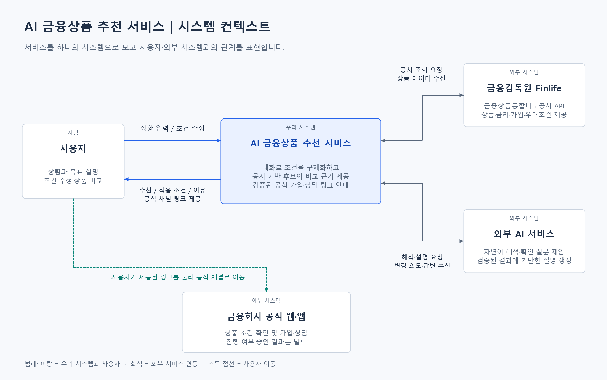
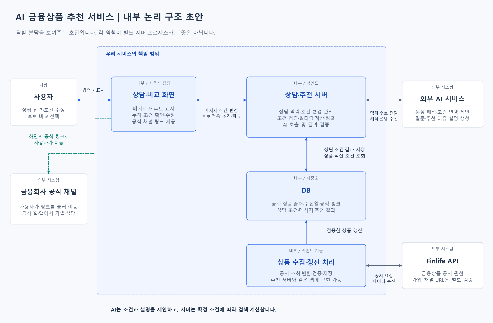

# AI 금융상품 추천 서비스의 시스템 경계와 논리 구조 초안

작성일: 2026-11-24 (한국 시간). 현재 기획에 따른 설계 제안이며 기술 스택·배포 단위·최초 구현 상품군은 확정하지 않는다.

## 1. 시스템 경계

사용자가 제시한 상담 화면·DB·추천 서버는 내부 요소로 적절하다. 다음처럼 책임을 구체화한다.

| 구분 | 요소 | 책임 |
|---|---|---|
| 내부 | 상담·비교 화면 | 상황 입력, 질문·후보·추천 이유 표시, 누적 조건 확인·수정·해제, 공식 링크 안내 |
| 내부 | 상담·추천 서버 | 상담 맥락과 직전 확정 조건 관리, 변경 의도 검증·반영, 후보 필터링·계산·정렬, AI 호출과 응답 검증 |
| 내부 | DB | 공시 원문·상품·옵션·기준일·수집일, 검증된 공식 링크, 상담 조건·메시지·추천 실행 결과 저장 |
| 내부 기능 | 상품 수집·갱신 처리 | Finlife 조회, 데이터 변환·검증·저장 및 수집 상태 관리. 같은 백엔드 앱에 구현 가능하며 별도 서버나 스케줄러 도입은 미정 |
| 외부 사람 | 사용자 | 자신의 상황을 설명하고 비교 조건을 수정하며 후보 선택 |
| 외부 시스템 | 금융감독원 금융상품통합비교공시(Finlife) API | 상품 공시 데이터 제공. 개인별 승인 결과나 상품 추천을 제공하는 시스템으로 취급하지 않음 |
| 외부 시스템 | 외부 AI 서비스(API로 호출) | 문장·대화 맥락 해석, 조건 변경과 확인 질문 제안, 검증된 비교 결과의 설명 생성 |
| 외부 시스템 | 금융회사 공식 웹·앱 | 사용자가 링크로 이동해 공식 조건 확인 및 가입·상담 진행 |

AI 호출과 서버의 계산 책임은 분리한다. 새 금액·기간·선호를 제안하는 것과 확정 상태에 반영하는 것을 구분한다. 명확한 수정 요청과 모호한 요청의 확인 기준은 후속 API·화면 설계에서 구체화한다.

## 2. 시스템 컨텍스트 다이어그램

C4의 시스템 컨텍스트 다이어그램은 우리 서비스를 하나의 박스로 표현하고 사람과 외부 시스템의 관계를 보여준다. 내부 화면·서버·DB는 이 수준에서 펼치지 않는다.

- 서비스는 Finlife에 공시를 요청해 데이터를 수신한다. 매 상담마다 실시간으로 원천 API를 호출한다는 의미는 아니다.
- 서비스는 외부 AI에 필요한 맥락과 검증된 후보를 전달하고 해석·설명을 받는다.
- 서비스가 사용자에게 검증된 공식 링크를 제공하면 사용자가 금융회사 채널로 이동한다. 초록 점선은 사용자 이동이며 서버 간 신청 API 연동을 뜻하지 않는다.
- 금융회사 채널은 이 사용자 여정의 외부 목적지로 표시했다. 우리 서버와의 직접 연동은 가정하지 않는다. 채널 이동으로 가입 완료나 승인 성공을 판정하지 않는다.

## 3. 내부 논리 구조 초안

내부 책임 분담을 이해하기 위한 별도 그림이다. 데이터 수집 기능과 서버를 나누어 그렸지만 별도 배포를 결정한 것은 아니다. C4 컨테이너 다이어그램으로 확정하려면 실제 애플리케이션·저장소 단위와 통신 방식을 추가로 정해야 한다.

최소 흐름은 다음과 같다.

1. 수집 기능이 Finlife 데이터를 조회·검증하고 DB를 갱신한다.
2. 화면이 사용자 문장과 상담 식별 정보를 서버에 전달한다.
3. 서버가 직전 확정 조건과 필요한 대화 맥락을 조회하고 AI에 해석을 요청한다. 명확한 조건 버튼 동작 등은 AI 없이 처리할 수 있다.
4. 서버가 해석 결과를 검증한다. 비교 결과를 크게 바꾸는 모호함이나 필수 정보 부족은 확인하고, 미응답 선호는 동의·거부로 간주하지 않는다.
5. 확정된 변경을 직전 조건에 반영하고 다른 조건은 유지한다. 서버가 DB 후보를 필터링·계산·정렬한다.
6. 필요한 경우 AI가 검증된 후보·계산·가정에 기반해 설명을 생성한다. 화면에는 적용된 전체 조건, 변경 사항, 결과와 확인할 조건을 표시한다.
7. 결과가 0건이면 유지 중인 조건과 완화 가능한 조건을 안내한다. 사용자 요청·확인 없이 조건을 해제하지 않는다.
8. 사용자가 고른 후보의 검증된 공식 가입·상담 경로로 이동한다.

가입 방법 문구만으로 상품별 공식 URL이 제공된다고 가정하지 않는다. 상품별 경로가 확인되면 사용하고, 확인되지 않으면 검증된 금융회사 안내 경로와 추가 탐색 필요성을 표시한다.

## 4. 사용자 시나리오의 보완 제안

- “이율이 좋은”은 기본금리와 최고 우대금리를 구분해 설명해야 한다. 비교 금액·기간을 맞추고, 실제 충족 여부가 미확인된 우대를 확정 적용하지 않는다. 예상 이자를 제시하면 가정을 함께 표시한다.
- “모호하면 확답을 얻는다”는 표현은 “필수 정보가 없거나 해석에 따라 결과가 크게 달라질 때 확인한다”로 좁힌다. 나머지는 미확인 표시·비교·선택지로 보완할 수 있다.
- “추가 요청을 기존 요청에 더한다”는 “추가·변경·해제 요청을 직전 확정 조건에 반영하고 나머지는 유지한다”로 바꾼다.
- 미완성인 비교 종료 기준은 다음으로 제안한다. “사용자가 현재 적용 조건과 주요 가입·우대조건을 이해하고, 후보의 선택 이유를 설명하며 공식 채널에서 추가 확인·가입을 진행할 후보를 고를 수 있다.” 채널 이동은 별도 행동이며 실제 가입 완료는 서비스의 확인 범위 밖이다.

## 5. 근거와 검증

C4 공식 문서 확인일: 2026-11-24. C4는 이 문서에서 제품 버전을 선택하는 기술이 아니라 다이어그램 작성 관점으로 사용한다.

- [C4 System context diagram](https://c4model.com/diagrams/system-context): 시스템 하나와 사용자·외부 시스템의 관계를 표현한다.
- [C4 Container diagram](https://c4model.com/diagrams/container): 애플리케이션·저장소로 확대해 책임·통신을 표현한다. 여기서 컨테이너는 Docker 컨테이너만을 뜻하지 않는다.

이미지 두 장을 로컬에서 생성한 뒤 글자·화살표·경계를 시각적으로 확인했다. 이미지 재생성: 저장소 루트에서 `./docs/render-architecture.ps1` 실행. 생성에는 Windows의 System.Drawing과 맑은 고딕을 사용한다. 구현 코드나 API 연결의 작동을 검증한 그림은 아니다.
