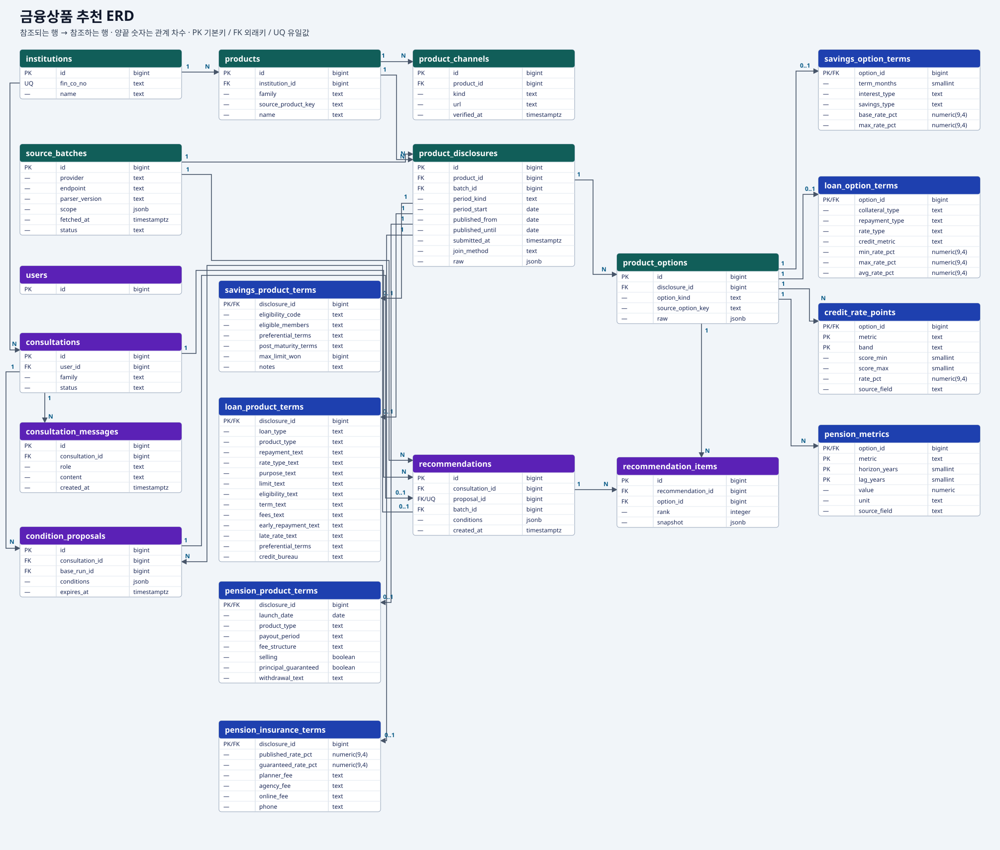

# 금융상품 추천 설계 초안

## 1. ERD 테이블 정의

PK는 행을 식별하는 기본키, FK는 다른 행을 참조하는 외래키다. 아래 이름과 키는 구현 설계안이다.

| 테이블 | PK 및 주요 FK | 저장하는 값과 역할 |
|---|---|---|
| institutions | id | 회사명, Finlife 회사 코드(문자열), 권역. 연금 회사명은 검증된 매핑을 통해 연결 |
| source_batches | id | 출처·엔드포인트·파서 버전, 조회 월/분기와 권역 범위, 수집 시각, 완료 여부. 페이지 일부 실패 시 공개하지 않음 |
| products | id, institution_id → institutions | 상품군, 출처별 식별값, 표시명. 내부 ID로 상담 결과와 공식 채널을 연결 |
| product_disclosures | id, product_id → products, batch_id → source_batches | 공시 제출월 또는 기준 분기/월, 공시 시작·종료일, 제출 시각, 가입 방법, 기본 원문 |
| product_options | id, disclosure_id → product_disclosures | 공시 내 옵션 종류, 옵션 식별 후보, 옵션 원문. 추천 후보가 참조하는 실제 비교 단위 |
| product_channels | id, product_id → products | 검증한 공식 URL과 검증 날짜, 상품 상세·회사 상담 등 채널 종류 |
| savings_product_terms | disclosure_id → product_disclosures | 예·적금 가입제한·대상, 우대조건, 만기 후 이자율, 최고한도, 유의사항 |
| savings_option_terms | option_id → product_options | 가입 개월, 이자계산 유형, 적립 유형(적금), 기본·최고 우대금리 |
| loan_product_terms | disclosure_id → product_disclosures | 대출군별 기본 조건. 비용·한도 설명, 개인신용 대출종류·CB, 사업자 상품구분·용도·기간·가입 세부요건 등 |
| loan_option_terms | option_id → product_options | 담보(주담대), 상환·금리 유형, 최저·최고·전월 평균, 개인신용 금리구분 |
| credit_rate_points | option_id → product_options + metric + band | 대출·기준·가산·가감 등 금리 종류와 점수 구간 또는 평균. 값과 원본 필드 보존 |
| pension_product_terms | disclosure_id → product_disclosures | 최초 판매일, 유형, 수령기간, 수수료 구조, 판매·원금보장 정보, 구 명세 중도해지 |
| pension_metrics | option_id → product_options + metric + horizon | 수익률, 수수료율, 적립금, 구 명세 납입원금. 지표별 단위와 기간/시차, 원본 필드 보존 |
| pension_insurance_terms | disclosure_id → product_disclosures | 공시이율, 최저보증이율, 채널별 비용 설명과 전화번호 |
| users | id | 상담 소유 계정 |
| consultations | id, user_id → users | 상담 상품군과 상태 |
| consultation_messages | id, consultation_id → consultations | 사용자 문장과 서비스 응답 |
| condition_proposals | id, consultation_id → consultations, base_run_id → recommendations(선택) | 확인 대기 조건, 기준 실행, 만료 시각 |
| recommendations | id, consultation_id → consultations, proposal_id → condition_proposals, batch_id → source_batches | 확정 입력·정렬 기준·근거 수집본, 실행 상태·시각 |
| recommendation_items | id, recommendation_id → recommendations, option_id → product_options | 순위, 비교 근거, 표시값 스냅샷 |



이 그림은 추천 흐름에 필요한 테이블을 보여준다. 기존 통합 기획의 회원 선호·등록 금융회사 등 지원 영역은 기존 기획 보고서를 참조한다.

## 그림을 읽는 순서

월 30만 원을 12개월 동안 넣고 싶은 사용자가 상담에서 A은행을 다시 포함한다고 가정한다. 상품 DB에는 A은행의 적금 하나가 있고, 그 상품에는 6개월과 12개월 옵션이 있다.

1. `institutions.id = 7`이 A은행이고 `products.institution_id = 7`인 상품들이 A은행 소속이다. 상품 입장에서는 **여러 상품 → 한 금융회사(N:1)**다.
2. 상품 42의 이번 달 공시가 101이라면 `product_disclosures.product_id = 42`로 연결한다. 공시 101의 12개월 옵션 501은 `product_options.disclosure_id = 101`을 갖는다. 상품 → 공시 → 옵션 순으로 내려가면 어떤 시점의 어떤 조건인지 찾을 수 있다.
3. 옵션 501의 기간과 금리는 `savings_option_terms.option_id = 501`에 둔다. 이 값은 기본키이기도 하므로 같은 옵션에 상세 행을 두 번 붙일 수 없다. 적금에서 상세를 갖춘 옵션과 상세는 **1:1**이다. 그림의 **1:0..1**은 옵션 전체를 기준으로 볼 때 대출 옵션 등에는 적금 상세가 0건이라는 뜻이다.
4. 같은 옵션 501이 여러 상담의 추천에 등장할 수 있고 한 추천에는 여러 옵션이 들어갈 수 있다. 추천과 옵션 사이의 **N:N**은 연결 테이블 `recommendation_items`로 구현한다. 예를 들어 `(추천 900, 옵션 501)` 행에는 당시 금리와 순위를 담는다. 연결표의 양쪽 화살표는 각각 1:N이다. 이 예시의 ID는 설명용이다.

**매핑**은 외부 응답을 읽어 우리 저장 칸으로 옮기는 규칙이다. 예를 들어 Finlife가 `{"fin_co_no":"0010001","save_trm":"12","intr_rate":3.1}`을 줬다고 가정한다. 서버는 `fin_co_no`의 앞자리 0을 유지해 회사 코드 칸으로 옮기고, `save_trm`은 정수 12로 바꿔 `term_months`에 넣고, `intr_rate`는 정확한 소수 3.1로 `base_rate_pct`에 넣는다. 서버가 사용자의 12개월과 DB의 `term_months`를 비교하는 이유가 여기서 나온다. `null` 금리는 값이 비어 있는 상태로 남긴다. 연금의 3년 수익률은 `pension_metrics`에서 지표와 관측 기간으로 저장한다. 가입 기간 필터에는 쓰이지 않는다.

### 화살표와 관계

| 참조되는 테이블 | 관계 | 참조하는 테이블 |
|---|---|---|
| `institutions` | 1 → N | `products` |
| `products` | 1 → N | `product_disclosures` |
| `source_batches` | 1 → N | `product_disclosures` |
| `product_disclosures` | 1 → N | `product_options` |
| `products` | 1 → N | `product_channels` |
| `product_disclosures` | 1 → 0..1 | `savings_product_terms` |
| `product_options` | 1 → 0..1 | `savings_option_terms` |
| `product_disclosures` | 1 → 0..1 | `loan_product_terms` |
| `product_options` | 1 → 0..1 | `loan_option_terms` |
| `product_options` | 1 → N | `credit_rate_points` |
| `product_disclosures` | 1 → 0..1 | `pension_product_terms` |
| `product_options` | 1 → N | `pension_metrics` |
| `product_disclosures` | 1 → 0..1 | `pension_insurance_terms` |
| `users` | 1 → N | `consultations` |
| `consultations` | 1 → N | `consultation_messages` |
| `consultations` | 1 → N | `condition_proposals` |
| `consultations` | 1 → N | `recommendations` |
| `condition_proposals` | 1 → 0..1 | `recommendations` |
| `recommendations` | 0..1 → N | `condition_proposals` |
| `source_batches` | 1 → N | `recommendations` |
| `recommendations` | 1 → N | `recommendation_items` |
| `product_options` | 1 → N | `recommendation_items` |

### 컬럼과 자료형

PostgreSQL을 예로 든 설계용 자료형이다. [PostgreSQL 자료형 문서](https://www.postgresql.org/docs/current/datatype.html) `bigint`는 큰 정수 ID·원 금액, `smallint`는 개월·점수 같은 작은 정수, `text`는 글자와 앞자리 0을 보존할 코드, `numeric`은 금리처럼 정확한 소수, `date`는 날짜, `timestamptz`는 시각, `boolean`은 예/아니요, `jsonb`는 구조가 달라질 수 있는 원문·검색 조건·스냅샷에 쓴다. PK/FK가 함께 있는 컬럼은 자기 행의 키이면서 부모 행의 참조값이다. 여러 열에 PK가 표시되면 그 열의 조합이 키다. 기본키와 필수 연결은 필수로 두고, 공시에서 빠질 수 있는 상세는 NULL을 허용한다. 연금 상품 식별값과 사업자 옵션 키의 유일 제약은 인증 실응답 검증 후 확정한다.

#### `institutions`

| 컬럼 | 자료형 | 키 |
|---|---|---|
| `id` | `bigint` | PK |
| `fin_co_no` | `text` | UQ |
| `name` | `text` | — |

#### `source_batches`

| 컬럼 | 자료형 | 키 |
|---|---|---|
| `id` | `bigint` | PK |
| `provider` | `text` | — |
| `endpoint` | `text` | — |
| `parser_version` | `text` | — |
| `scope` | `jsonb` | — |
| `fetched_at` | `timestamptz` | — |
| `status` | `text` | — |

#### `products`

| 컬럼 | 자료형 | 키 |
|---|---|---|
| `id` | `bigint` | PK |
| `institution_id` | `bigint` | FK |
| `family` | `text` | — |
| `source_product_key` | `text` | — |
| `name` | `text` | — |

#### `product_disclosures`

| 컬럼 | 자료형 | 키 |
|---|---|---|
| `id` | `bigint` | PK |
| `product_id` | `bigint` | FK |
| `batch_id` | `bigint` | FK |
| `period_kind` | `text` | — |
| `period_start` | `date` | — |
| `published_from` | `date` | — |
| `published_until` | `date` | — |
| `submitted_at` | `timestamptz` | — |
| `join_method` | `text` | — |
| `raw` | `jsonb` | — |

#### `product_options`

| 컬럼 | 자료형 | 키 |
|---|---|---|
| `id` | `bigint` | PK |
| `disclosure_id` | `bigint` | FK |
| `option_kind` | `text` | — |
| `source_option_key` | `text` | — |
| `raw` | `jsonb` | — |

#### `product_channels`

| 컬럼 | 자료형 | 키 |
|---|---|---|
| `id` | `bigint` | PK |
| `product_id` | `bigint` | FK |
| `kind` | `text` | — |
| `url` | `text` | — |
| `verified_at` | `timestamptz` | — |

#### `savings_product_terms`

| 컬럼 | 자료형 | 키 |
|---|---|---|
| `disclosure_id` | `bigint` | PK/FK |
| `eligibility_code` | `text` | — |
| `eligible_members` | `text` | — |
| `preferential_terms` | `text` | — |
| `post_maturity_terms` | `text` | — |
| `max_limit_won` | `bigint` | — |
| `notes` | `text` | — |

#### `savings_option_terms`

| 컬럼 | 자료형 | 키 |
|---|---|---|
| `option_id` | `bigint` | PK/FK |
| `term_months` | `smallint` | — |
| `interest_type` | `text` | — |
| `savings_type` | `text` | — |
| `base_rate_pct` | `numeric(9,4)` | — |
| `max_rate_pct` | `numeric(9,4)` | — |

#### `loan_product_terms`

| 컬럼 | 자료형 | 키 |
|---|---|---|
| `disclosure_id` | `bigint` | PK/FK |
| `loan_type` | `text` | — |
| `product_type` | `text` | — |
| `repayment_text` | `text` | — |
| `rate_type_text` | `text` | — |
| `purpose_text` | `text` | — |
| `limit_text` | `text` | — |
| `eligibility_text` | `text` | — |
| `term_text` | `text` | — |
| `fees_text` | `text` | — |
| `early_repayment_text` | `text` | — |
| `late_rate_text` | `text` | — |
| `preferential_terms` | `text` | — |
| `credit_bureau` | `text` | — |

#### `loan_option_terms`

| 컬럼 | 자료형 | 키 |
|---|---|---|
| `option_id` | `bigint` | PK/FK |
| `collateral_type` | `text` | — |
| `repayment_type` | `text` | — |
| `rate_type` | `text` | — |
| `credit_metric` | `text` | — |
| `min_rate_pct` | `numeric(9,4)` | — |
| `max_rate_pct` | `numeric(9,4)` | — |
| `avg_rate_pct` | `numeric(9,4)` | — |

#### `credit_rate_points`

| 컬럼 | 자료형 | 키 |
|---|---|---|
| `option_id` | `bigint` | PK/FK |
| `metric` | `text` | PK |
| `band` | `text` | PK |
| `score_min` | `smallint` | — |
| `score_max` | `smallint` | — |
| `rate_pct` | `numeric(9,4)` | — |
| `source_field` | `text` | — |

#### `pension_product_terms`

| 컬럼 | 자료형 | 키 |
|---|---|---|
| `disclosure_id` | `bigint` | PK/FK |
| `launch_date` | `date` | — |
| `product_type` | `text` | — |
| `payout_period` | `text` | — |
| `fee_structure` | `text` | — |
| `selling` | `boolean` | — |
| `principal_guaranteed` | `boolean` | — |
| `withdrawal_text` | `text` | — |

#### `pension_metrics`

| 컬럼 | 자료형 | 키 |
|---|---|---|
| `option_id` | `bigint` | PK/FK |
| `metric` | `text` | PK |
| `horizon_years` | `smallint` | PK |
| `lag_years` | `smallint` | PK |
| `value` | `numeric` | — |
| `unit` | `text` | — |
| `source_field` | `text` | — |

#### `pension_insurance_terms`

| 컬럼 | 자료형 | 키 |
|---|---|---|
| `disclosure_id` | `bigint` | PK/FK |
| `published_rate_pct` | `numeric(9,4)` | — |
| `guaranteed_rate_pct` | `numeric(9,4)` | — |
| `planner_fee` | `text` | — |
| `agency_fee` | `text` | — |
| `online_fee` | `text` | — |
| `phone` | `text` | — |

#### `users`

| 컬럼 | 자료형 | 키 |
|---|---|---|
| `id` | `bigint` | PK |

#### `consultations`

| 컬럼 | 자료형 | 키 |
|---|---|---|
| `id` | `bigint` | PK |
| `user_id` | `bigint` | FK |
| `family` | `text` | — |
| `status` | `text` | — |

#### `consultation_messages`

| 컬럼 | 자료형 | 키 |
|---|---|---|
| `id` | `bigint` | PK |
| `consultation_id` | `bigint` | FK |
| `role` | `text` | — |
| `content` | `text` | — |
| `created_at` | `timestamptz` | — |

#### `condition_proposals`

| 컬럼 | 자료형 | 키 |
|---|---|---|
| `id` | `bigint` | PK |
| `consultation_id` | `bigint` | FK |
| `base_run_id` | `bigint` | FK |
| `conditions` | `jsonb` | — |
| `expires_at` | `timestamptz` | — |

#### `recommendations`

| 컬럼 | 자료형 | 키 |
|---|---|---|
| `id` | `bigint` | PK |
| `consultation_id` | `bigint` | FK |
| `proposal_id` | `bigint` | FK/UQ |
| `batch_id` | `bigint` | FK |
| `conditions` | `jsonb` | — |
| `created_at` | `timestamptz` | — |

#### `recommendation_items`

| 컬럼 | 자료형 | 키 |
|---|---|---|
| `id` | `bigint` | PK |
| `recommendation_id` | `bigint` | FK |
| `option_id` | `bigint` | FK |
| `rank` | `integer` | — |
| `snapshot` | `jsonb` | — |

## 2. 공식 명세 확인과 매핑

Finlife 브라우저에서 7개 탭을 확인했다. 6개는 결과변수 표를 직접 확인했고, 연금저축은 이관 안내를 따라 통합연금포털에서 현행·과거 상품별 API와 원리금보장 보험 API의 요청·결과표를 확인했다. 인증키로 실제 응답을 수집하는 검증은 남아 있다.

| 상품군 | 기본 행 → 기본 상세 | 옵션·관측값 → 비교 상세 | 공식 출처 |
|---|---|---|---|
| 정기예금 | `join_deny`, `join_member`, `spcl_cnd`, `max_limit`, `mtrt_int`, `etc_note` | `save_trm`, `intr_rate_type(_nm)`, `intr_rate`, `intr_rate2` | [정기예금](https://finlife.fss.or.kr/finlife/api/fdrmDpstApi/list.do?menuNo=700052) |
| 적금 | 정기예금과 같은 기본 상세 | 예금 옵션 + `rsrv_type(_nm)`. 공식 예제에서 같은 상품의 12개월에 정액·자유적립식이 함께 나온다 | [적금](https://finlife.fss.or.kr/finlife/api/fdrmEntyApi/list.do?menuNo=700053) |
| 주택담보대출 | `loan_inci_expn`, `erly_rpay_fee`, `dly_rate`, `loan_lmt` | `mrtg_type(_nm)`, `rpay_type(_nm)`, `lend_rate_type(_nm)`, `lend_rate_min/max/avg` | [주택담보대출](https://finlife.fss.or.kr/finlife/api/houseMrtgApi/list.do?menuNo=700055) |
| 전세자금대출 | 주택담보와 같은 기본 상세 | 상환·금리 유형 및 금리 범위·평균. 결과표에 담보 유형이 없다 | [전세자금대출](https://finlife.fss.or.kr/finlife/api/lfstsFundsApi/list.do?menuNo=700056) |
| 개인신용대출 | `crdt_prdt_type(_nm)`, `cb_name` | `crdt_lend_rate_type(_nm)`, `crdt_grad_{1,4,5,6,10,11,12,13,avg}`. 900점 초과~300점 이하 구간과 평균을 명시 매핑 | [개인신용대출](https://finlife.fss.or.kr/finlife/api/indvlCrdtApi/list.do?menuNo=700057) |
| 개인사업자대출 | `fin_prdt_type(_nm)`, `loan_type`, `rpay_type`, `lend_rate_type`, `use_way`, `loan_limit(_detl)`, `join_deny(_detl)`, `spcl_rate`, `loan_term`, 비용·연체·CB | `lend_rate_min/max/avg` 및 `val{1,2,3}_grad_{1..8,avg}`. 세 계열은 대출·기준·가산금리 | [개인사업자대출](https://finlife.fss.or.kr/finlife/api/indvlBusiApi/list.do?menuNo=700075) |
| 연금저축 | `area`, `company`, `product`, `launchDate`, `productType`, `rcvMethod`, `feeType`, `sells`, `guarantees` | 현행 분기 API의 `reserve[1–3]` 및 `reserve`, `earnRate1/3/5/7`, `feeRate10`, `avgTotalEarRate`, `avgFeeRate`. 별도 보험 API는 `reportDate`, `publishedInterestRate`, `guaranteedInterestRate`, 채널별 수수료 설명, 전화번호 | [이관 안내](https://finlife.fss.or.kr/finlife/api/anntySvingsApi/list.do?menuNo=700054) · [현행 분기](https://www.fss.or.kr/fss/lifeplan/devlopGuide/listInfo4.do?menuNo=201053) · [보험](https://www.fss.or.kr/fss/lifeplan/devlopGuide/listInfo3.do?menuNo=201053) |

[이전 연금 명세](https://www.fss.or.kr/fss/lifeplan/devlopGuide/listInfo2.do?menuNo=201053)는 `balance` 계열과 과거 시점·장기 평균 수익률/수수료율을 따로 제공한다. 특히 구 명세의 `earnRate1`은 과거 1년, 현행 명세에서는 현재 1년 수익률로 설명된다. 그래서 수집본에 엔드포인트와 파서 버전을 남기고 필드 이름, 지표 종류, 기간과 시차를 같이 보관한다. 경계 분기의 조회 가능 범위 및 지표 단위는 실제 응답과 공식 설명으로 확인한다. 보험의 이율과 과거 실적 수익률은 서로 다른 지표로 표시한다.

## 3. 왜 이렇게 연결하는가

1. **상품과 공시를 분리한다.** 같은 상품의 금리나 판매 정보는 다음 달·분기에 바뀐다. 상품 ID는 유지하고 공시를 추가하면, 이전 추천이 참조한 공시와 옵션을 그대로 찾을 수 있다. Finlife에서는 상품군·회사 코드·상품 코드로 상품 식별을 시도하고, 기본 행과 옵션은 명세의 공시 제출월도 같이 대조한다. 같은 월의 재수집과 수정은 수집본별로 보존한다.
2. **상품과 옵션을 분리한다.** 적금 12개월에도 정액·자유적립식이 모두 들어올 수 있다. 예금 옵션은 기간·이자 유형, 적금은 적립 유형 추가, 주담대는 담보·상환·금리 유형, 전세는 상환·금리 유형, 신용은 금리구분을 옵션 식별 후보로 삼는다. 사업자 결과표의 상환·금리방식은 기본 행에 있고 옵션에는 금리 값이 주로 있다. 유일성이 확인될 때까지 옵션 행에 공시 내 내부 ID를 부여하고 원문 행을 보존한다. 금리 값이나 응답 순서를 장기 식별값으로 사용하지 않는다.
3. **공통 관계 위에 상품군별 상세를 둔다.** 상품명과 공식 채널은 공통으로 다룬다. 예금의 12개월 가입기간과 연금의 3년 수익률 관측 기간은 서로 다른 의미다. 연금은 분기 관측 또는 보험 공시를 추천 단위로 쓰며 외부 행에 옵션 배열이 없어도 내부 비교 옵션 한 건을 만들어 연결한다. 두 연금 엔드포인트의 회사·상품 이름만으로 동일 상품을 자동 병합하지 않는다. 공개 결과표에 안정된 상품 코드가 없으므로 출처 범위 안에서 내부 ID와 확인된 매핑을 쓴다.
4. **점수별 금리는 행으로 저장한다.** 개인신용의 불연속 필드와 사업자의 연속 필드를 점수 경계·평가사·금리 종류로 매핑한다. 평균은 별도 구분값으로 관리한다. 값이 없으면 결측으로 유지하고 0의 의미는 실응답 검증 후 확정한다. 대출 금리나 한도 설명은 공시 값으로 표시한다.
5. **추천에는 당시 입력과 출력도 보존한다.** 공시 옵션 FK로 출처를 찾고, 스냅샷으로 당시 적용 조건·표시 금리·정렬 근거를 복원한다. 옵션이 없는 공시의 상세는 상품 조회로 제공할 수 있고, 비교에 필요한 근거가 있는 옵션만 추천 후보로 사용한다.

상세 테이블은 부모와 같은 상품군을 참조하도록 검증한다. 추천 실행·옵션은 같은 상품군과 공개 수집본을 참조해야 한다. 분기 실적과 보험 공시를 함께 보여줄 때는 보험을 상세 보조 정보로 취급하고, 별도 기준월과 출처를 붙인다. 후보 0건은 정상 실행과 0개 후보로, 수집 실패는 사용 가능한 데이터 없음으로 표현한다.

## 4. 서비스 흐름에서 API로 이어지는 순서

1. **서비스 흐름.** 상품군과 조건을 확인하고 후보를 비교한다. 조건 일부를 바꾸면 나머지를 유지하고, 비교 후 공식 채널로 이동한다.
2. **시스템 행동.** 화면 → 서버가 문장을 보내면, AI는 해석한 변경 의도를 돌려준다. 서버가 회사 코드와 상품군별 허용 조건을 검증하고 확인안을 만든다. 사용자가 확인하면 서버가 공개된 수집본을 조회한다.
3. **데이터 검증.** 실응답에서 권역·페이지 범위와 기본 행–옵션 연결을 확인한다. 한도·기간 문구는 단위가 검증되면 필터에 사용한다. 특히 사업자 옵션 중복과 연금 상품 매핑은 데이터 확보 후 확정한다.
4. **저장과 응답.** 사용자 입력은 추천 실행에, 선택 옵션과 당시 표시값은 추천 후보에 남긴다. 화면에는 확정 조건, 상품군별 결과, 공시 기준과 판단 한계를 반환한다.

## 5. API 계약 변경안

### 어떤 시스템이 누구에게 연결하는가

| 출발 → 도착 | 기능 | 보내는 값 → 받는 값 | 이 연결을 둔 이유 |
|---|---|---|---|
| 사용자 → 상담 화면 | 상담 시작·자연어 입력·조건 확인 | 상품군, 문장, 확인 클릭 → 확인안·후보·공식 링크 | 사용자가 서버가 이해한 조건을 눈으로 확인하고 수정할 수 있다. |
| 상담 화면 → 내부 서버 | 상담 생성 및 대화 | 상품군 또는 상담 ID·문장 → 상담 ID, 추가 질문 또는 확인안 ID·조건 | 화면의 문장을 서버가 현재 상담과 연결하고 상담 소유권을 검사한다. |
| 내부 서버 → 외부 AI | 문장 해석 | 문장·필요한 직전 조건·허용 동작 → 변경 의도 또는 확인 질문 | “A은행 다시 포함”을 제외 해제로 구조화한다. 회사 코드 대조와 검색 조건 확정은 서버에서 한다. |
| 상담 화면 → 내부 서버 | 확인 후 추천 실행 | 상담 ID·확인안 ID → 적용 조건·공시 기준·후보 | 사용자가 본 확인안과 실제 검색이 같은 조건에 묶인다. |
| 내부 서버 → 내부 DB | 상담 상태 및 비교 후보 조회 | 상담 ID·상품군·확정 필터 → 이전 조건·공시 옵션; 실행 후 입력과 결과 저장 | 코드로 검증한 기준을 일관되게 적용하고 당시 결과를 복원한다. |
| 내부 수집 작업 → 외부 Finlife | 예·적금 및 대출 공시 수집 | 서버 인증키·권역·페이지 → 상품 기본 행, 옵션, 페이지 상태 | 고객 요청과 별도로 전체 조회 범위를 검증하고 완전한 수집본을 공개한다. |
| 내부 수집 작업 → 외부 통합연금포털 | 연금 공시 수집 | 별도 인증키·연도·분기·권역(또는 보험 권역·채널) → 기간별 실적·수수료 또는 보험 공시 | 연금의 출처와 기준 시점이 다르므로 별도 요청과 변환 규칙이 필요하다. |
| 상담 화면 → 내부 서버 | 상세와 이력 복원 | 상담·실행·후보 ID → 당시 조건·금리·비교 근거·확인한 URL | 금리가 나중에 바뀌어도 그때 본 정보를 재현한다. |
| 사용자 브라우저 → 금융회사 공식 사이트 | 가입·상담 페이지 이동 | 검증된 URL로 이동 → 금융회사 화면 | 실제 가입 절차는 금융회사 채널에서 진행한다. 상담 문장이나 납입액은 링크에 붙이지 않는다. |

적금 한 건을 따라가면, 화면은 `POST /api/consultations/12/messages`로 `{"text":"A은행은 다시 포함해줘"}`를 보낸다. AI가 `{"action":"remove_excluded_bank","bank_name":"A은행"}`을 반환하면 서버는 기존 제외 목록의 A은행 코드만 제거한 확인안을 만든다. 사용자가 확인하면 화면은 `POST /api/consultations/12/recommendations`에 `{"proposalId":"p_42"}`를 보낸다. 서버는 저장된 확인안의 **월 30만 원·12개월·B은행 제외**로 DB를 검색하고, 적용 조건과 12개월 옵션의 금리를 응답한다. 사용자가 모호한 표현을 쓰면 첫 요청에 질문을 반환하고 확인안 적용과 검색을 보류한다.

상담 생성 → 문장 해석 → 확인 → 추천 실행 → 후보 상세라는 기존 경로를 유지한다. 각 상담은 한 상품군으로 고정한다. 다른 상품군을 비교하려면 새 상담을 생성한다. 로그인 상담 재개와 이력 복원은 설계 가정이다.

| API | 요청과 응답 | 변경 이유 |
|---|---|---|
| `POST /api/consultations` | `productFamily`는 `term_deposit`, `installment_savings`, `pension_savings`, `mortgage`, `jeonse_loan`, `personal_credit_loan`, `business_loan` 중 하나. 201 + ID | 상품군마다 받을 조건과 비교 기준이 다르다. 기존 초안의 `savings`는 적금으로 대응한다 |
| `POST /api/consultations/{id}/messages` | `text` → 200, 확인 질문 또는 `proposalId`와 검증된 조건 | AI는 변경 의도를 전달하고 서버가 상품군별 허용 조건과 기존 확정 상태를 검증한다 |
| `POST /api/consultations/{id}/recommendations` | `proposalId` → 201, 적용 조건·출처·후보 | 단일 금리 필드 대신 상품군별 지표와 공시 기준이 필요하다 |
| `GET /api/consultations/{id}` | 200, 상품군·대화·마지막 실행 ID | 상담 복원 |
| `GET /api/consultations/{id}/recommendations/{runId}` | 200, 실행 당시 조건과 후보 스냅샷 | 새 공시가 들어와도 과거 결과 복원 |
| `GET /api/consultations/{id}/recommendations/{runId}/items/{itemId}` | 200, 당시 비교값·추가 확인 사항·검증된 공식 채널 | 가입 방법 문구와 실제 공식 URL의 역할이 다르다 |

| 상품군 | 조건 예시 | 응답의 비교 상세 |
|---|---|---|
| 예금 | 예치액, 가입 개월 | 이자 유형, 기간별 기본·최고 우대금리 |
| 적금 | 월 납입액, 가입 개월, 적립 유형 | 예금과 같은 금리 지표 + 적립 유형, 한도 확인 상태 |
| 연금저축 | 상품 유형, 판매 여부, 비교할 관측 기간 | 기준 분기, 기간별 관측 수익률·수수료율. 보험의 공시·보증이율은 기준월과 별도 표시 |
| 주택담보·전세 | 대출 희망액, 상환·금리 방식, 주담대 담보 | 최저·최고·전월 취급 평균금리. 설명형 한도는 확인 필요 표시 |
| 개인신용 | 대출 종류·점수 구간(선택) | 평가사와 구간별 금리. 비교할 금리 종류를 구분 |
| 개인사업자 | 자금 용도·희망액·점수 구간(선택) | 한도·기간 설명, 금리 범위, 점수별 대출·기준·가산금리 |

응답 예시의 상품·수치는 가상이다. `details.kind`로 응답 구조를 식별하고 `period.kind`로 달력 월과 분기를 구분한다. 요청에 포함된 희망 기간이나 희망액은 공시에서 확인된 경우에만 후보 필터로 사용한다.

```json
{
  "recommendationId": "r_43",
  "productFamily": "pension_savings",
  "appliedConditions": {"metric": "annualized_return", "horizonYears": 3},
  "source": {
    "provider": "fss_pension_portal",
    "period": {"kind": "quarter", "year": 2026, "quarter": 3},
    "freshness": "current"
  },
  "items": [
    {
      "itemId": "i_1",
      "productName": "예시 연금저축",
      "details": {
        "kind": "pension_performance",
        "annualizedReturnPercent": 3.1,
        "horizonYears": 3
      },
      "limitations": ["historical_performance"]
    }
  ]
}
```

서버는 출처별 상품군의 동종 지표로 정렬한다. 검색 성공 0건은 `items: []`, 사용 가능한 공시 수집본 부재는 503을 반환한다. 상담 소유권을 확인하고, 만료됐거나 더 최신 조건으로 대체된 변경안은 409를 반환한다. 같은 변경안을 재전송하면 이미 생성된 실행을 반환한다. 확인된 추천과 후보 저장은 트랜잭션 안에서 처리하고 변경안당 실행을 하나로 제한한다.

확정 조건은 상품군과 함께 검증한다. 예를 들어 적금 조건은 `monthlyAmountWon`, `termMonths`, `excludedInstitutionCodes`, `sort`를 사용한다. “A은행을 다시 포함해줘”는 제외 회사 코드 배열에서 A은행만 제거한다. 응답의 `details.kind`는 `deposit_rate`, `savings_rate`, `pension_performance`, `mortgage_range`, `jeonse_range`, `personal_credit_bands`, `business_credit_rates` 중 하나로 제안한다. 현행 보험 공시는 연금 상세의 `insuranceDisclosure`에 독립된 출처 및 기준월과 함께 반환한다.

후보에는 공통으로 `itemId`, `productName`, `institutionName`, `details`, `limitations`가 들어간다. 수집본 안에서 상품별 공시 제출월이 다르면 후보에도 `disclosurePeriod`를 붙인다. 금리는 퍼센트 숫자로 반환하고 미공시는 `null`이다. 신용은 점수 상·하한과 금리 종류가 붙은 배열을, 사업자는 같은 배열과 옵션의 금리 범위를 함께 반환한다.

**검증 사례.** 12개월 정액·자유적립식 두 옵션 보존, 담보 유형이 없는 전세 응답 허용, 신용·사업자의 같은 점수 구간 매핑 확인, 구·신 연금의 같은 필드명 오매핑 방지, 새 공시 적용 후 과거 추천 복원.

